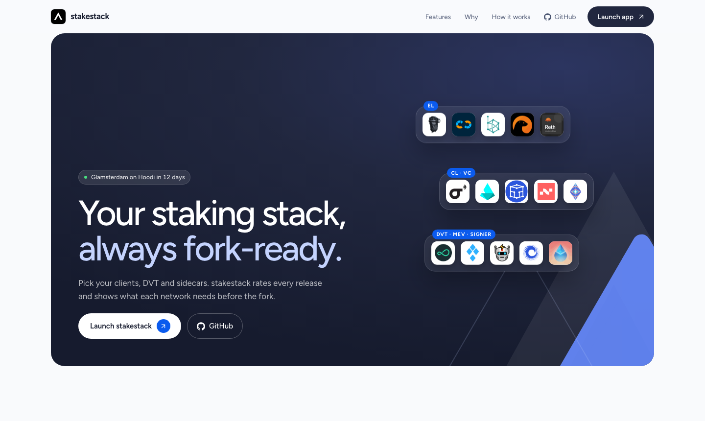
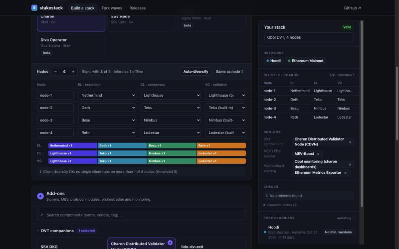
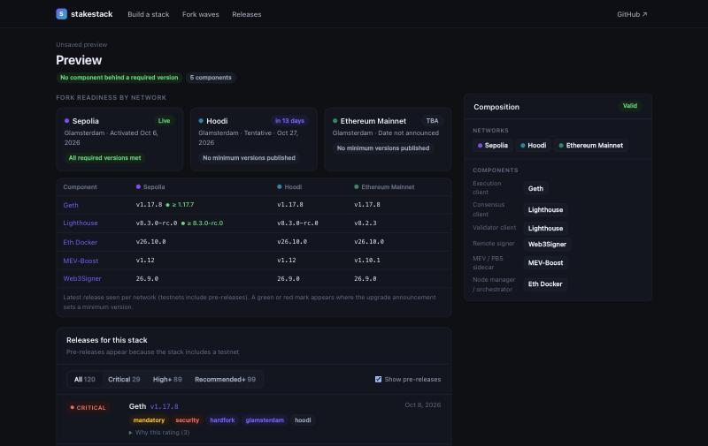
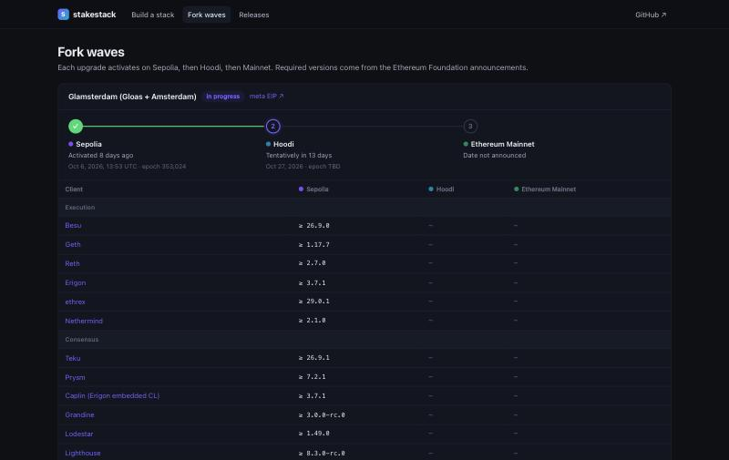
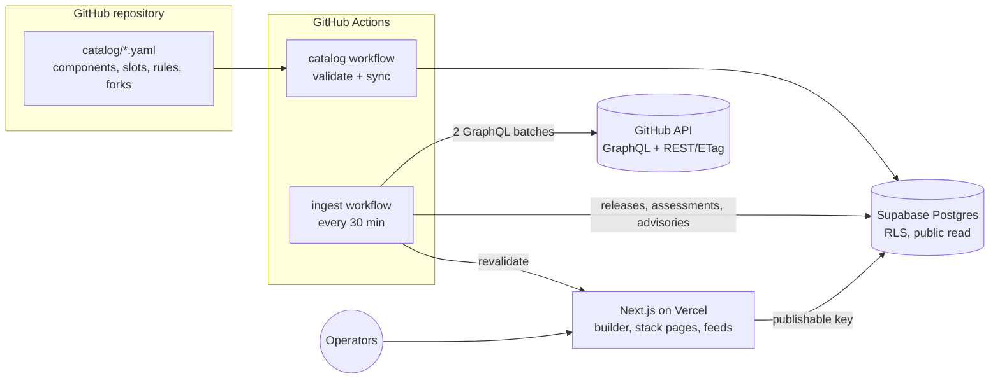

<div align="center">

# stakestack

**Every Ethereum staking release that matters, for your exact stack.**

Open-source stack builder and release-intelligence tracker for Ethereum validator operators.
Compose your execution, consensus and validator clients, DVT cluster (Obol Charon, SSV), MEV sidecar, remote signer and protocol modules,
then get every relevant release rated by severity and see hard fork readiness network by network: **Sepolia → Hoodi → Mainnet**.

[**Website**](https://stakestack-eth.vercel.app) ·
[Build a stack](https://stakestack-eth.vercel.app/build) ·
[Fork timeline](https://stakestack-eth.vercel.app/upgrades) ·
[Releases](https://stakestack-eth.vercel.app/releases)

[](https://github.com/kimhg2/stakestack/actions/workflows/ci.yml)
[](https://github.com/kimhg2/stakestack/actions/workflows/ingest.yml)
[](LICENSE)




</div>

---

## Why stakestack

Running validators professionally means watching dozens of open-source projects at once: 6+ execution clients, 6+ consensus clients,
standalone validator clients, DVT middleware, remote signers, MEV-Boost, protocol sidecars like the Lido validator-ejector, node managers and monitoring.

- **Releases are scattered.** Each project publishes on its own GitHub repo, on its own schedule.
- **Urgency is written differently everywhere.** Lighthouse and Reth ship an *Update Priority* table, Nimbus writes *Urgency guidance*, Geth says *recommended for all users*, Teku lists *Breaking Changes*. Nobody normalises it.
- **Forks roll out in waves.** Every hard fork activates on Sepolia, then Hoodi, then Mainnet, each with its own date and minimum client versions. Operators who run testnet validators need to upgrade weeks before mainnet.
- **DVT multiplies the matrix.** An Obol or SSV cluster runs a *different* EL/CL pair on every node for client diversity, so one cluster can depend on eight clients.

Generic GitHub release notifiers tell you *that* something was released. stakestack tells you **whether it matters for the software you actually run, and by when.**

## Features

| | |
|---|---|
| **Stack builder** | Pick clients slot by slot or start from a template (solo staker, minority clients, Obol 4-node DVT, SSV operator, Lido CSM, Rocket Pool). Composition rules enforce what fits together. |
| **DVT cluster editor** | For Charon and SSV, assign EL/CL/VC per node. stakestack computes the signing threshold (`ceil(2n/3)`), fault tolerance, and warns when one client runs on more nodes than the cluster can lose. One click auto-diversifies. |
| **Severity-rated releases** | Every release gets `critical`, `high`, `recommended`, `optional` or `unrated`, plus flags such as `security`, `mandatory`, `hardfork`, `breaking`. The rating always shows the release-note evidence it came from. The releases page filters by severity, type (security, hard fork, mandatory, breaking, …), component role, network, fork, channel and date; every badge is a filter and the view is shareable by URL. |
| **Fork readiness per network** | For each network in your stack: the current upgrade, its activation date or countdown, the minimum version per client from the EF announcement, and whether a compliant release exists. |
| **Fork timeline** | Glamsterdam, Fusaka and Pectra across Sepolia, Hoodi and Mainnet, with epochs, dates and a client × network version matrix. Tentative dates are labelled as such. |
| **Feeds** | Each saved stack has an RSS and a JSON feed. Pipe them into Slack, Telegram, Discord, n8n or an email digest. |
| **Open catalog** | 78 components defined in YAML in this repo. Adding a tool is a pull request. |
| **Budget-safe GitHub ingestion** | The whole catalog is polled with 2 GraphQL requests (~2 points). Hard per-run ceilings make it safe to share a token with other automation. |

<table>
<tr>
<td width="50%"><br><sub><b>DVT cluster editor.</b> One EL/CL/VC per node, threshold and client-diversity check, and the "Your stack" panel with every pick, check and fork status.</sub></td>
<td width="50%"><br><sub><b>Fork readiness.</b> Latest release per network vs the minimum version each upgrade requires.</sub></td>
</tr>
<tr>
<td colspan="2"><br><sub><b>Fork waves.</b> Sepolia activated, Hoodi tentatively scheduled, Mainnet TBA, with the official client version table.</sub></td>
</tr>
</table>

## What is tracked

78 components across the whole staking stack. The source of truth is [`catalog/components/*.yaml`](catalog/components).

| Category | Components |
|---|---|
| **Execution clients** (7) | [Geth](https://github.com/ethereum/go-ethereum) · [Nethermind](https://github.com/NethermindEth/nethermind) · [Besu](https://github.com/hyperledger/besu) · [Erigon](https://github.com/erigontech/erigon) · [Reth](https://github.com/paradigmxyz/reth) · [ethrex](https://github.com/lambdaclass/ethrex) _beta_ · [Nimbus (execution)](https://github.com/status-im/nimbus-eth1) _experimental_ |
| **Consensus & validator clients** (9) | [Lighthouse](https://github.com/sigp/lighthouse) · [Prysm](https://github.com/OffchainLabs/prysm) · [Teku](https://github.com/Consensys/teku) · [Nimbus](https://github.com/status-im/nimbus-eth2) · [Lodestar](https://github.com/ChainSafe/lodestar) · [Grandine](https://github.com/grandinetech/grandine) · [Caplin (Erigon embedded CL)](https://github.com/erigontech/erigon) _beta_ · [Vouch](https://github.com/attestantio/vouch) · [Vero](https://github.com/serenita-org/vero) |
| **Distributed validators (DVT)** (7) | [Charon](https://github.com/ObolNetwork/charon) · [Charon Distributed Validator Node (CDVN)](https://github.com/ObolNetwork/charon-distributed-validator-node) · [lido-dv-exit](https://github.com/ObolNetwork/lido-dv-exit) · [SSV Node](https://github.com/ssvlabs/ssv) · [Anchor](https://github.com/sigp/anchor) _beta_ · [SSV DKG](https://github.com/ssvlabs/ssv-dkg) · [Diva Operator](https://github.com/ShamirLabs/diva-alpha-net) _beta_ |
| **Remote signers** (2) | [Web3Signer](https://github.com/Consensys/web3signer) · [Dirk](https://github.com/attestantio/dirk) |
| **MEV / PBS** (4) | [MEV-Boost](https://github.com/flashbots/mev-boost) · [Commit-Boost](https://github.com/Commit-Boost/commit-boost-client) · [MEV-Boost Relay](https://github.com/flashbots/mev-boost-relay) · [mev-rs](https://github.com/ralexstokes/mev-rs) _experimental_ |
| **Staking protocols** (9) | [Lido CSM](https://github.com/lidofinance/community-staking-module) · [Lido SimpleDVT](https://github.com/lidofinance/lido-dao) · [Lido Validator Ejector](https://github.com/lidofinance/validator-ejector) · [Lido Keys API](https://github.com/lidofinance/lido-keys-api) · [Rocket Pool Smart Node](https://github.com/rocket-pool/smartnode) · [NodeSet Hyperdrive](https://github.com/nodeset-org/hyperdrive) · [StakeWise V3 Operator](https://github.com/stakewise/v3-operator) · [EigenLayer CLI](https://github.com/Layr-Labs/eigenlayer-cli) · [Puffer Coral](https://github.com/PufferFinance/coral) _beta_ |
| **Node managers** (8) | [Eth Docker](https://github.com/eth-educators/eth-docker) · [EthPillar](https://github.com/coincashew/EthPillar) · [Stereum](https://github.com/stereum-dev/ethereum-node) · [DAppNode](https://github.com/dappnode/DNP_DAPPMANAGER) · [Sedge](https://github.com/NethermindEth/sedge) · [NiceNode](https://github.com/NiceNode/nice-node) · [eth-docker-ansible](https://github.com/yorickdowne/eth-docker-ansible) · [Ethereum on ARM](https://github.com/diglos/ethereumonarm) |
| **Key & deposit tooling** (6) | [ethstaker-deposit-cli](https://github.com/eth-educators/ethstaker-deposit-cli) · [staking-deposit-cli](https://github.com/ethereum/staking-deposit-cli) _deprecated_ · [Wagyu Key Gen](https://github.com/stake-house/wagyu-key-gen) · [ethdo](https://github.com/wealdtech/ethdo) · [ethereal](https://github.com/wealdtech/ethereal) _maintenance_ · [eth2-val-tools](https://github.com/protolambda/eth2-val-tools) _maintenance_ |
| **Monitoring, UI & infra** (14) | [Obol monitoring](https://github.com/ObolNetwork/monitoring) · [Ethereum Metrics Exporter](https://github.com/ethpandaops/ethereum-metrics-exporter) · [Lido Validators Monitoring](https://github.com/lidofinance/ethereum-validators-monitoring) · [eth-validator-watcher](https://github.com/kilnfi/eth-validator-watcher) · [eth-duties](https://github.com/TobiWo/eth-duties) · [ETHDuties Tracker](https://github.com/shayanb/ethduties) · [beaconcha.in explorer](https://github.com/gobitfly/eth2-beaconchain-explorer) · [Dora](https://github.com/ethpandaops/dora) · [Checkpointz](https://github.com/ethpandaops/checkpointz) · [Contributoor](https://github.com/ethpandaops/contributoor) · [Siren](https://github.com/sigp/siren) · [Prysm Web UI](https://github.com/OffchainLabs/prysm-web-ui) _maintenance_ · [Grafana](https://github.com/grafana/grafana) · [Prometheus](https://github.com/prometheus/prometheus) |
| **Specs & network configs** (12, watch-only) | [consensus-specs](https://github.com/ethereum/consensus-specs) · [execution-specs](https://github.com/ethereum/execution-specs) · [execution-apis](https://github.com/ethereum/execution-apis) · [beacon-APIs](https://github.com/ethereum/beacon-APIs) · [builder-specs](https://github.com/ethereum/builder-specs) · [ethereum/pm](https://github.com/ethereum/pm) · [mainnet](https://github.com/eth-clients/mainnet) · [hoodi](https://github.com/eth-clients/hoodi) · [sepolia](https://github.com/eth-clients/sepolia) · [holesky](https://github.com/eth-clients/holesky) _deprecated_ · [Ephemery](https://github.com/ephemery-testnet/ephemery-genesis) · [EthStaker guides](https://github.com/eth-educators/ethstaker-guides) |

Missing a tool? [Add it](#adding-a-component) in a few lines of YAML.

## How severity is rated

Ratings are **rule-based and explainable**. Each release is parsed with the assessor that matches how its team writes release notes,
then a keyword pass adds signals such as `security`, `hard fork` or `breaking change`. Details: [docs/ASSESSMENT.md](docs/ASSESSMENT.md).

| Severity | Meaning for an operator | Typical trigger |
|---|---|---|
| `critical` | Upgrade now, likely a security fix | security flag and a high score |
| `high` | Upgrade before a deadline (fork) or the team says you must | `mandatory` or `hardfork` flag, or High priority in the team's table |
| `recommended` | Next maintenance window | medium signals |
| `optional` | Nothing urgent | low signals |
| `unrated` | No signal found; read the notes | nothing matched |

| Assessor | Used for | Signal parsed |
|---|---|---|
| `lighthouse-table` | Lighthouse, Siren, Anchor | *Update Priority* table (BN/VC rows) |
| `reth-table` | Reth | *Update Priority* table (payload builder rows) |
| `nimbus-urgency` | Nimbus | *Urgency guidance* paragraph |
| `geth-prose` | Geth | "recommended for all users", hotfix, DoS fixes, fork enablement |
| `teku-notes` | Teku, Besu, Web3Signer | *Breaking Changes*, "required for the fork" |
| `prysm-notes` | Prysm | *Security* heading, required/recommended statements |
| `charon-notes` | Charon, CDVN | breaking changes, cluster-wide upgrades |
| `generic` | everything else | keyword scoring |

Timelines rank releases by `score × priority_weight`, so a `recommended` Geth release outranks a `recommended` Grafana release.
Spec and network-config repos are capped at `high`. A manual override table always wins over the rules.

> Ratings are a triage signal, not a substitute for reading the release notes before you upgrade production validators.

## DVT clusters and client diversity

When you pick **Obol Charon** or **SSV**, the builder switches to a per-node cluster editor.

- **Threshold.** Defaults to `ceil(2n/3)`: 4 nodes sign with 3, 7 with 5, 10 with 7. The cluster tolerates `n − threshold` nodes offline.
- **Diversity check.** A bug in one client takes down every node that runs it. If any EL, CL or VC runs on more nodes than the cluster can lose, stakestack warns you, per role.
- **Auto-diversify.** Assigns a different EL/CL pair to each node, restricted to clients that support the middleware (for Charon, VCs that work with Charon's validator API).
- **Node names.** Label nodes with your real hostnames, for example `ovh-fra-val01`.
- **SSV** hides the validator slot because the SSV node performs duties itself.

## Fork waves

Every network upgrade is modelled as a **wave** across `sepolia → hoodi → mainnet`, with activation epoch and time, the EF announcement link,
the minimum version per client, and `verified` / `tentative` flags. Values are edited by hand from the official announcement in
[`catalog/networks.yaml`](catalog/networks.yaml); nothing is scraped into it automatically.

Current state (October 2026): **Glamsterdam** activated on Sepolia on 2026-10-06 at epoch 353,024. Hoodi is tentatively scheduled for 2026-10-27 (epoch TBD). Mainnet is not announced.

## Feeds and alerts

Every saved stack exposes:

```text
https://<your-deployment>/api/feed/<stack-id>.rss
https://<your-deployment>/api/feed/<stack-id>.json
```

Items include severity, flags, networks and the evidence lines. Some ways to use them:

- **Slack:** `/feed subscribe https://<your-deployment>/api/feed/<stack-id>.rss`
- **Discord / Telegram:** any RSS bot, or an n8n / Zapier "RSS → message" flow filtered on `category = critical`.
- **Scripts:** poll the JSON feed and page on-call when a `critical` item appears.

## Architecture



| Package | What it does |
|---|---|
| [`catalog/`](catalog) | YAML catalog (components, slots and composition rules, networks and fork waves) with JSON Schemas |
| [`packages/shared`](packages/shared) | Types, catalog loader/validator, `compose()` rules engine, DVT `topology`, `computeReadiness()`, presets |
| [`packages/ingest`](packages/ingest) | Budgeted GitHub ingester, release assessors, catalog sync, migrations, stats |
| [`apps/web`](apps/web) | Next.js 16 app: landing page, builder, stack pages, fork timeline, releases, RSS/JSON feeds |
| [`supabase/migrations`](supabase/migrations) | SQL schema with row-level security |
| [`.github/workflows`](.github/workflows) | CI, 30-minute ingest cron, catalog validate/sync |

The same `compose()` function runs in the browser, in the API and in the readiness engine, so the builder, saved stacks and feeds never disagree.

The UI follows the Parataxis design system shared with stakeops: tokens (colour, type scale, radii, shadows) live once in
[`apps/web/app/globals.css`](apps/web/app/globals.css), type is Figtree with IBM Plex Mono for versions, and icons come from
[Lucide](https://lucide.dev). The app header carries a live UTC clock because fork activations are announced in UTC.

## Self-hosting

You need a GitHub account, a [Supabase](https://supabase.com) project and a [Vercel](https://vercel.com) account. All three have free tiers that are enough.

### 1. Local setup

```bash
git clone https://github.com/kimhg2/stakestack.git
cd stakestack
pnpm install
cp .env.example .env    # fill in the values below
pnpm catalog:validate
pnpm db:migrate         # applies supabase/migrations (no psql needed)
pnpm catalog:sync       # YAML catalog -> Supabase
pnpm ingest -- --backfill
pnpm dev                # http://localhost:3000
```

Without Supabase the web app still runs read-only from the YAML catalog.

### 2. Environment variables

The full annotated list is in [`.env.example`](.env.example). The required ones:

| Variable | Used by | Where to get it |
|---|---|---|
| `NEXT_PUBLIC_SUPABASE_URL` | web, ingest | Supabase › Project Settings › API |
| `NEXT_PUBLIC_SUPABASE_PUBLISHABLE_KEY` | web | Supabase › API Keys › Publishable key (`sb_publishable_…`) |
| `SUPABASE_SECRET_KEY` | ingest, web (server only) | Supabase › API Keys › Secret key (`sb_secret_…`). The web server uses it only for member stacks after verifying the sign-in; give Vercel its own key (e.g. `stakestack-web`) and never prefix it with `NEXT_PUBLIC_`. |
| `SUPABASE_DB_URL` | migrations | Supabase › Connect › Session pooler |
| `GITHUB_TOKEN` | ingest (local runs) | Fine-grained PAT, public repositories, **no permissions**. In Actions the built-in token is used unless you set `STAKESTACK_GITHUB_TOKEN`. |
| `REVALIDATE_SECRET` | web, ingest | `openssl rand -hex 32` |
| `NEXT_PUBLIC_SITE_URL` | web, ingest | Your deployment URL. The ingester only sends the secret to a host that identifies itself as stakestack. |
| `NEXT_PUBLIC_PRIVY_APP_ID`, `PRIVY_APP_SECRET` | web (optional) | Privy dashboard › App settings. Turns on GitHub / Google sign-in; setup in [docs/AUTH.md](docs/AUTH.md). |
| `GOOGLE_SITE_VERIFICATION` | web (optional) | Google Search Console › HTML tag. Indexing steps in [docs/SEO.md](docs/SEO.md). |

### 3. Deploy

1. **GitHub:** add secrets `NEXT_PUBLIC_SUPABASE_URL`, `SUPABASE_SECRET_KEY`, `REVALIDATE_SECRET`, variable `NEXT_PUBLIC_SITE_URL`, and create a `production` environment. `STAKESTACK_GITHUB_TOKEN` is optional: without it the workflow uses the built-in `github.token`, which is plenty for ~2 GraphQL points per run.
2. **Vercel:** import the repo with root directory `apps/web`; set `NEXT_PUBLIC_SUPABASE_URL`, `NEXT_PUBLIC_SUPABASE_PUBLISHABLE_KEY`, `REVALIDATE_SECRET`, `NEXT_PUBLIC_SITE_URL`. For sign-in and member stacks also set `NEXT_PUBLIC_PRIVY_APP_ID`, `PRIVY_APP_SECRET` and a web-only `SUPABASE_SECRET_KEY` ([docs/AUTH.md](docs/AUTH.md)).
3. Push to `main`. The `catalog` workflow syncs the catalog, `ingest` runs every 30 minutes.

### GitHub API budget

The ingester is designed to share a token with other projects ([docs/GITHUB_API_SPEC.md](docs/GITHUB_API_SPEC.md)):

- 40 repositories per GraphQL request using aliases; the whole catalog costs about 2 points per poll.
- REST only for security advisories, with `If-None-Match`; `304` responses are free.
- Hard per-run ceilings (25 GraphQL points, 120 REST requests) and a floor on the token's remaining quota.

## Adding a component

Add an entry to the matching file in [`catalog/components/`](catalog/components):

```yaml
- slug: my-sidecar
  name: My Sidecar
  vendor: Example Labs
  summary: One line on what operators use it for.
  roles: [monitoring]
  repo: example/my-sidecar
  stable_tag_pattern: '^v\d+\.\d+\.\d+$'
  networks: [mainnet, hoodi]
  status: active
  assessor: generic
  priority_weight: 0.7
```

Then run `pnpm catalog:validate` and open a pull request. CI checks the schema and that the repository exists.
For its logo, save `apps/web/public/logos/<slug>.svg` (or `.png`); [docs/LOGOS.md](docs/LOGOS.md) lists sources and the components still missing one.
Composition rules (for example "Lido CSM requires the validator-ejector") live in [`catalog/slots.yaml`](catalog/slots.yaml).
See [CONTRIBUTING.md](CONTRIBUTING.md).

## Roadmap

- [x] Catalog of 78 staking components with composition rules
- [x] Budgeted GitHub ingestion and rule-based severity with evidence
- [x] Fork waves with per-network minimum versions
- [x] DVT cluster editor with client-diversity checks
- [x] RSS / JSON feeds per stack
- [ ] Email and Telegram alerts per stack
- [ ] Paste `web3_clientVersion` / beacon `node/version` output to fill running versions automatically
- [ ] LLM-assisted rating for releases the rules leave unrated (always with quoted evidence)
- [ ] Docker image tag tracking for compose-based setups
- [ ] Draft fork entries from EF blog RSS for human confirmation

## FAQ

**Is this an alerting service?** It is a tracker with feeds. Point your existing alerting at the RSS/JSON feed of your stack.

**Where do fork dates come from?** From Ethereum Foundation announcements, entered by hand. Dates from All Core Devs notes that are not yet announced are marked *tentative*.

**Why are pre-releases shown?** Testnet forks often require release candidates. Stacks that include Sepolia or Hoodi see pre-releases; mainnet-only views do not.

**Can I trust the ratings blindly?** No. They are a triage aid with the evidence attached. Read the release notes before upgrading.

## Contributing

Issues and pull requests are welcome: new components, better assessors for a client's release-note format, fork data corrections, UI improvements.
Please include a real release-note excerpt as a test case when you change an assessor.

## Contact

Questions, feedback or partnerships: [kimhg@parataxiseth.co.kr](mailto:kimhg@parataxiseth.co.kr).

## License

[MIT](LICENSE). Not affiliated with the Ethereum Foundation or any client team. Client names and logos belong to their owners.

---

<details>
<summary><b>한국어 소개</b></summary>

**stakestack**은 이더리움 밸리데이터 운영자를 위한 오픈소스 스택 구성 도구이자 릴리즈 추적기입니다.

- EL, CL, VC, DVT(Obol Charon, SSV), MEV-Boost, Web3Signer, Lido CSM, Rocket Pool 등 78개 오픈소스를 원하는 조합으로 구성합니다.
- 내가 쓰는 소프트웨어의 릴리즈만 모아 critical, high, recommended로 등급을 매기고, 근거가 된 릴리즈 노트 문장을 함께 보여줍니다.
- 하드포크는 Sepolia, Hoodi, Mainnet 순서로 진행됩니다. 네트워크별 활성화 일정과 클라이언트 최소 버전, 내 스택의 준비 상태를 한눈에 보여줍니다.
- DVT 클러스터는 노드마다 다른 EL/CL을 지정할 수 있고, 한 클라이언트가 허용 가능한 장애 노드 수보다 많은 노드에서 돌면 경고합니다.
- 저장한 스택마다 RSS/JSON 피드가 생겨 Slack, Telegram 등 기존 알림 체계에 바로 연결할 수 있습니다.

[라이브 앱 바로가기](https://stakestack-eth.vercel.app)

</details>
